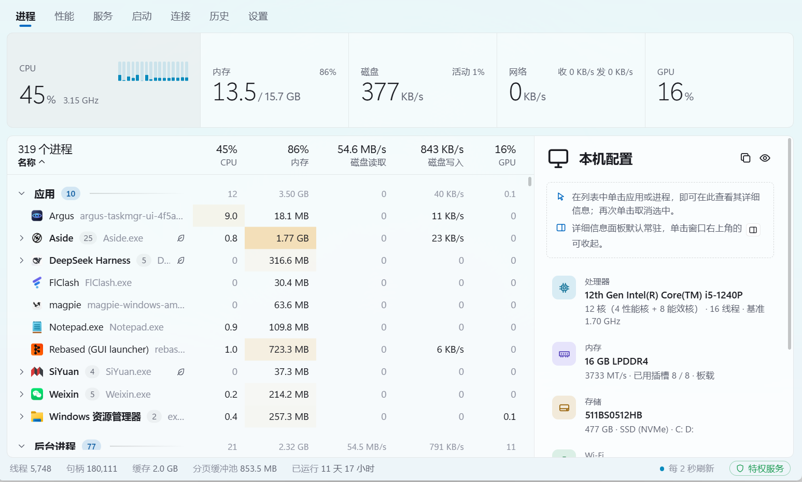

<div align="center">


# Vigil

**快速、现代、信息丰富的 Windows 任务管理器**

</div>

<br>

<p align="center">
  
</p>

<br>

Vigil 通过 Rust 直接读取 Windows 原生接口，以 Tauri 2 与 SolidJS 构建界面。进程、性能、服务、启动项、网络连接以及最近 7 天的历史记录集中在同一窗口中，曲线随屏幕刷新率连续流动；常驻托盘时约占用单个 CPU 核心的 1%。名称取自希腊神话中的百眼巨人阿尔戈斯（Vigil Panoptes）。

## ✨ 特性

||功能|说明|
|:-:|-|-|
|🧮|**进程**|按应用、进程树或列表查看，包括每个进程的磁盘读写速率与 GPU 占用；启用特权服务或以管理员身份运行时另含网络流量。支持排序、搜索、结束进程或整个进程树；详细信息面板显示命令行、用户、完整性级别等。|
|⚡|**优先级与效率模式**|通过右键菜单设置，也可建立规则，在程序每次启动时自动应用。|
|📈|**性能**|CPU（每核心、性能核与能效核、频率、温度、功耗）、内存、磁盘、网络、GPU 与电池。|
|🧩|**服务与启动项**|启动、停止服务及修改启动类型；启用或禁用启动项，与系统任务管理器使用同一开关。|
|🌐|**连接与端口**|TCP 与 UDP 端点及其所属进程，支持按端口精确搜索和断开连接。|
|🔍|**文件占用**|将文件或文件夹拖放到窗口，结合 Restart Manager 与句柄枚举查找占用进程，包括进程的当前目录；借助特权服务可检查更多进程。|
|🕘|**历史回溯**|最近 7 天的资源曲线，单击任意时刻即可查看当时占用最高的进程。|
|📌|**常驻托盘**|通过全局快捷键 Ctrl+Alt+Esc（可更改或停用）显示或隐藏窗口；隐藏时资源占用极低，最小化与后台常驻时的刷新间隔可分别设置。|
|🔄|**应用内更新**|新版本在后台下载，就绪后在标题栏提示，安装前可查看当前版本之后的全部更新内容，更新后首次打开窗口时显示新版本的变化；提供稳定版与测试版两个通道，可选 GitHub 加速代理；仅安装通过签名校验的版本。|
|🎨|**原生外观**|Mica 背景与系统强调色，深色、浅色主题默认跟随系统，也可在设置中指定。|
|🌍|**多语言**|简体中文与英文界面，默认跟随 Windows 显示语言；首次启动时引导完成常用设置。|
|👤|**无需管理员权限**|以标准用户身份即可查看全部进程的路径与资源占用。|
|🛡️|**可选特权服务**|经一次管理员授权后，以标准权限运行的界面同样可以管理系统进程、自动应用规则、统计每进程网络流量（Windows 11 24H2 之前的系统上还包括磁盘读写）、控制服务及断开连接；可在设置中卸载。|

## 💻 系统要求

* Windows 11 x64
* WebView2 运行时（Windows 11 已内置）

## 🔧 从源码构建

需要 Rust（stable，MSVC 工具链）、Node.js 22.18 及以上版本（23.x 需 23.6 及以上）、pnpm，以及 Visual Studio Build Tools（“使用 C++ 的桌面开发”）。在仓库根目录运行：

```bash
start.bat           # 开发模式：前端即时热更新，Rust 代码修改后自动重新编译并重启
start.bat build     # 发布构建，生成 target\\release\\vigil.exe
```

浏览器预览、检查、打包安装程序和清理缓存等其他命令，参见[开发指南](docs/development/README.md)。

## 🔑 快捷键

|操作|按键|
|-|-|
|切换页面|<kbd>Ctrl</kbd>+<kbd>1</kbd> … <kbd>Ctrl</kbd>+<kbd>7</kbd>|
|搜索进程|<kbd>Ctrl</kbd>+<kbd>F</kbd>|
|打开详细信息|<kbd>Enter</kbd>|
|结束进程|<kbd>Delete</kbd>（<kbd>Shift</kbd>+<kbd>Delete</kbd> 跳过确认）|
|显示或隐藏窗口（全局）|<kbd>Ctrl</kbd>+<kbd>Alt</kbd>+<kbd>Esc</kbd>|

完整的操作说明参见[使用指南](docs/guide/README.md)。

## 📚 文档

|文档|内容|
|-|-|
|[使用指南](docs/guide/README.md)|界面与操作、常驻与快捷键、设置、硬件数据的来源与限制|
|[开发指南](docs/development/README.md)|环境与命令、构建与缓存、性能基线与测量|
|[架构](docs/architecture/README.md)|分层与数据流、各模块职责|
|[设计](docs/design/README.md)|设计原则、曲线动画、窗口外观|
|[路线图](docs/roadmap.md)|已完成与计划中的功能|
|[已知问题](docs/known-issues.md)|当前版本的限制|
|[更新日志](CHANGELOG.md)|各版本的变更|

## 🤝 参与贡献

欢迎提交问题与拉取请求，请先阅读[贡献指南](.github/CONTRIBUTING.md)。安全漏洞请按[安全策略](.github/SECURITY.md)私下报告，不要创建公开的 Issue。

## 🧭 路线图

* \[x] **M0–M3**：进程、性能、服务、启动项、网络连接与文件占用
* \[x] 多语言、首次启动引导与应用内更新
* \[ ] **M4**：已完成每进程 GPU 占用与磁盘读写、优先级与效率模式规则、历史回溯；ETW 每进程网络流量仍在进行
* \[ ] **M5**：已完成可选特权服务、规则与网络采集接入、按句柄查询文件占用；[系统任务管理器替换](docs/architecture/task-manager.md)仍在进行
* \[x] 可选 CPU 内核传感器：每核读数、有效频率、电压与功耗限制，开启时自动准备官方 PawnIO 驱动；AMD／Intel 显卡遥测；[硬件支持范围](docs/guide/hardware-data.md)
* \[ ] 快捷键扩展：区分左右修饰键，支持仅由修饰键或两个普通键组成的组合

详情参见[路线图](docs/roadmap.md)。

## 🙏 致谢

Vigil 构建于以下开源项目之上，在此致谢：

|项目|用途|
|-|-|
|[Tauri](https://tauri.app/) 及其插件|应用宿主、托盘、开机启动与应用内更新|
|[WebView2](https://developer.microsoft.com/microsoft-edge/webview2/)、[webview2-com](https://github.com/wravery/webview2-rs)|界面渲染|
|[windows-rs](https://github.com/microsoft/windows-rs)|Windows 原生接口的 Rust 绑定|
|[SolidJS](https://www.solidjs.com/)、[TanStack Virtual](https://tanstack.com/virtual)|界面框架与长列表虚拟滚动|
|[Vite](https://vite.dev/)、[Tailwind CSS](https://tailwindcss.com/)、[TypeScript](https://www.typescriptlang.org/)、[Biome](https://biomejs.dev/)|前端构建、样式与代码检查|
|[serde](https://serde.rs/)、[reqwest](https://github.com/seanmonstar/reqwest) 等 Rust crate|序列化、网络请求等基础功能|
|[PawnIO](https://pawnio.eu/)、[PawnIO.Modules](https://github.com/namazso/PawnIO.Modules)|可选内核传感器使用的签名驱动与模块|
|[ZenStates-Core](https://github.com/irusanov/ZenStates-Core)、[LibreHardwareMonitor](https://github.com/LibreHardwareMonitor/LibreHardwareMonitor)、[GNR-SMU](https://github.com/Kyworn/gnr-smu)|AMD SMU 表等 CPU 寄存器布局|
|[Intel IGCL](https://github.com/intel/drivers.gpu.control-library)、[AMD ADL](https://github.com/GPUOpen-LibrariesAndSDKs/display-library)|显卡遥测接口|


## 📄 许可证

Vigil 是自由软件，依据 [MIT 许可证](LICENSE) 发布。

<div align="center">
<br>
<sub>Vigil · Windows 任务管理器 · © 2026 Vigil contributors</sub>
</div>

